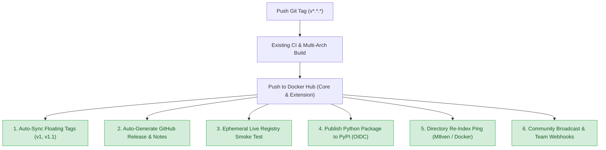

# Rover-Slim Post-Release Review & Autonomous Pipeline Blueprint

## 1. Executive Summary

With the successful rollout of **Rover-Slim v1.1.2**, the continuous integration and Docker Hub multi-arch publishing pipeline (`linux/amd64`, `linux/arm64`) is operating smoothly. However, historically, several post-release activities were either performed manually, required reminders, or were temporarily missed (such as syncing the GitHub Action `v1` floating tag).

This document provides:
1. **Retrospective Review**: What was automated vs. what required manual execution across `v1.0.0` through `v1.1.2`.
2. **Prospective Scope**: Additional post-release activities necessary for enterprise-grade distribution, directory compliance, and developer adoption.
3. **Zero-Touch Automation Blueprint**: Concrete GitHub Actions configurations and webhook integrations that allow future releases to execute all post-release tasks 100% autonomously without any manual prompts.

---

## 2. Retrospective: Activities Performed in Past Releases

| Release Activity | v1.0.0 | v1.1.0 | v1.1.1 | v1.1.2 | Current Execution Model |
| :--- | :---: | :---: | :---: | :---: | :--- |
| **Multi-Arch Docker Build & Push** (`amd64`/`arm64`) | ✅ | ✅ | ✅ | ✅ | **Automated** in `.github/workflows/release-extension.yml` |
| **Docker Hub Overview & Readme Sync** | ❌ (Manual) | ❌ (Manual) | ✅ | ✅ | **Automated** via `peter-evans/dockerhub-description@v4` |
| **GitHub Release & Changelog Notes** | ❌ (Manual) | ❌ (Manual) | ❌ (Manual) | ❌ (Manual) | **Manual** (Created via `gh release create` / web UI) |
| **GitHub Action Floating Tag (`v1`) Sync** | N/A | N/A | ❌ (Manual) | ⚠️ **Missed** | **Manual** (Currently stuck on commit `1196db5` / v1.1.1) |
| **Live Registry Smoke Test** (Pull verification) | ❌ (Local) | ❌ (Local) | ❌ (Local) | ❌ (Local) | **Manual** (User checks `docker pull` or `rdctl extension`) |
| **M8ven Trust Index / Directory Refresh** | N/A | N/A | N/A | ❌ (Manual) | **Manual** (Visiting `m8ven.ai` / manual re-scrape) |
| **Community Distribution & Outreach** | ❌ (None) | 📄 Playbook | 📄 Playbook | 📄 Playbook | **Manual** (Copying text from `docs/LAUNCH_PLAYBOOK.md`) |
| **Demo Walkthrough & Asset Update** | ❌ | 📄 Script | 📄 Script | 📄 Script | **Manual** (`docs/DEMO_RECORDING_SCRIPT.md`) |

### Key Observations & Friction Points:
1. **The Floating Tag Drift**:
   - In `v1.1.1`, the `v1` tag was manually updated so `uses: SankarGaneshb/rover-slim@v1` worked.
   - In `v1.1.2`, the tag was created as `v1.1.2`, but `v1` was not moved forward. Any consumer pointing to `@v1` is still on `v1.1.1`.
2. **Uncertainty on Local Execution**:
   - Because CI ends right after pushing to Docker Hub without a live validation step, developers wonder whether local commands (`rdctl extension install`, `docker pull`) need to be run.
3. **Manual Release Note Drafting**:
   - Release titles, changelog categorization, and asset references were assembled manually rather than derived from semantic commit messages.

---

## 3. Prospective Scope: Future Post-Release Requirements

For future releases (`v1.2.0`, `v2.0.0`, etc.), the post-release lifecycle should expand to include:



### Detailed Activities:
1. **Floating Major & Minor Action Tags**: Automatically force-update `v1` (and `v1.1`) to the release commit whenever a semver tag `v1.*.*` is published.
2. **Automated GitHub Release with Categorized Notes**: Group commits automatically under `🚀 Features`, `🐛 Fixes`, `🛡️ Security & MCP`, and `📦 Dependencies`.
3. **Post-Deployment Smoke Test (Registry Verification)**: A headless runner pulls `bsankarganesh/rover-slim-extension:latest` directly from Docker Hub and executes `rover-slim --version` and GoA Sentinel health checks to guarantee the published image is 100% operational.
4. **PyPI Trusted Publishing (Zero Credentials)**: Package `rover-slim` wheel and publish to PyPI using GitHub's OIDC OpenID Connect token without storing static API keys.
5. **M8ven & Directory Re-Indexing Webhook**: Trigger an automatic HTTP POST/GET to indexers to crawl updated MCP tool annotations immediately upon release.
6. **ChatOps Broadcast (Slack / Discord / Discussions)**: Post an automated release card with size reduction benchmarks and install snippets to developer communication channels.
7. **Social Distribution Payload Generation**: Automatically render ready-to-share Reddit, HN, and X markdown snippets directly into the GitHub Actions Job Summary.

---

## 4. Zero-Touch Automation Architecture

To run all of these automatically without you needing to inform or trigger anything, we can extend `.github/workflows/release-extension.yml` with four downstream chained jobs that execute right after `build-and-publish`:

### Architecture Flow:
```yaml
jobs:
  build-and-publish:
    # Existing multi-arch builds...

  post-release-tag-sync:
    needs: build-and-publish
    # Moves floating tags (e.g. v1) automatically

  post-release-github-release:
    needs: build-and-publish
    # Drafts & publishes official release notes

  post-release-smoke-test:
    needs: build-and-publish
    # Pulls fresh image from Docker Hub & runs GoA checks

  post-release-directory-ping:
    needs: post-release-smoke-test
    # Pings M8ven and generates social distribution drafts
```

---

## 5. Implementation Specification

Here is the exact workflow configuration to add to `.github/workflows/release-extension.yml`:

```yaml
  # --------------------------------------------------------------------------
  # 1. Autonomous Floating Tag Sync (v1, v1.1)
  # --------------------------------------------------------------------------
  sync-floating-tags:
    name: Sync GitHub Action Floating Major Tags (v1)
    runs-on: ubuntu-latest
    needs: build-and-publish
    permissions:
      contents: write
    steps:
      - name: Checkout Repository
        uses: actions/checkout@v4
        with:
          fetch-depth: 0

      - name: Determine Major and Minor Tags
        id: tags
        run: |
          TAG=${GITHUB_REF_NAME}
          MAJOR=$(echo "$TAG" | cut -d. -f1)
          MINOR=$(echo "$TAG" | cut -d. -f1,2)
          echo "major=$MAJOR" >> $GITHUB_OUTPUT
          echo "minor=$MINOR" >> $GITHUB_OUTPUT

      - name: Update Floating Tags
        run: |
          git config user.name "github-actions[bot]"
          git config user.email "github-actions[bot]@users.noreply.github.com"
          
          # Force update major tag (e.g., v1)
          git tag -fa "${{ steps.tags.outputs.major }}" -m "Rover-Slim ${{ steps.tags.outputs.major }} Floating Release Tag"
          git push origin "${{ steps.tags.outputs.major }}" --force
          
          # Force update minor tag (e.g., v1.1)
          git tag -fa "${{ steps.tags.outputs.minor }}" -m "Rover-Slim ${{ steps.tags.outputs.minor }} Floating Minor Tag"
          git push origin "${{ steps.tags.outputs.minor }}" --force

  # --------------------------------------------------------------------------
  # 2. Automated GitHub Release Publication
  # --------------------------------------------------------------------------
  publish-github-release:
    name: Auto-Generate GitHub Release & Changelog
    runs-on: ubuntu-latest
    needs: build-and-publish
    permissions:
      contents: write
    steps:
      - name: Checkout Repository
        uses: actions/checkout@v4
        with:
          fetch-depth: 0

      - name: Create GitHub Release
        env:
          GH_TOKEN: ${{ secrets.GITHUB_TOKEN }}
        run: |
          gh release create "${{ github.ref_name }}" \
            --title "Rover-Slim ${{ github.ref_name }} Release" \
            --generate-notes \
            --verify-tag

  # --------------------------------------------------------------------------
  # 3. Live Registry Smoke Test (Verification Probe)
  # --------------------------------------------------------------------------
  verify-live-registry:
    name: Live Registry Smoke Test & GoA Validation
    runs-on: ubuntu-latest
    needs: build-and-publish
    steps:
      - name: Pull Released Extension from Docker Hub
        run: |
          docker pull ${{ secrets.DOCKERHUB_USERNAME }}/rover-slim-extension:latest
          docker pull ${{ secrets.DOCKERHUB_USERNAME }}/rover-slim:latest

      - name: Verify Core Engine Execution
        run: |
          docker run --rm ${{ secrets.DOCKERHUB_USERNAME }}/rover-slim:latest --version
          docker run --rm ${{ secrets.DOCKERHUB_USERNAME }}/rover-slim:latest --help

      - name: Post-Release Verification Succeeded
        run: |
          echo "### 🚀 Live Registry Verification Passed" >> $GITHUB_STEP_SUMMARY
          echo "Successfully pulled and verified both Extension and Core images from Docker Hub." >> $GITHUB_STEP_SUMMARY

  # --------------------------------------------------------------------------
  # 4. M8ven Re-Index Ping & Community Launch Summary
  # --------------------------------------------------------------------------
  post-release-indexing-and-social:
    name: Directory Indexing & Launch Payload Generation
    runs-on: ubuntu-latest
    needs: verify-live-registry
    steps:
      - name: Trigger M8ven Directory Refresh (Optional Webhook/Ping)
        continue-on-error: true
        run: |
          curl -s -X POST "https://m8ven.ai/api/v1/mcp/refresh?repo=sankarganeshb/rover-slim" || true

      - name: Generate Community Launch Cards in Job Summary
        run: |
          cat << 'EOF' >> $GITHUB_STEP_SUMMARY
          ## 📢 Post-Release Community Launch Cards Ready

          The release is officially verified on Docker Hub. Copy-paste launch snippets for community distribution:

          ### 🐦 X / LinkedIn
          > Rover-Slim ${{ github.ref_name }} is live! Shrink Docker containers by 80% with AST dependency pruning & GoA sentinel health checks.
          > Install: \`rdctl extension install bsankarganesh/rover-slim-extension:latest\`
          > Repo: https://github.com/SankarGaneshb/rover-slim

          ### 💬 Docker Community Slack (#extensions)
          > Hey everyone! Rover-Slim ${{ github.ref_name }} is now available on Docker Hub & Extensions Marketplace. Check out the latest release notes: https://github.com/SankarGaneshb/rover-slim/releases/tag/${{ github.ref_name }}
          EOF
```

---

## 6. Immediate Next Steps for v1.1.2

1. **Synchronize the `v1` Tag Now**:
   - `v1` is currently pointing to commit `1196db5` (v1.1.1).
   - Move `v1` forward to commit `00b7c58` (`v1.1.2`) so that consumers of the GitHub Action automatically pick up the M8ven annotations and v1.1.2 release.
2. **Incorporate the Post-Release Jobs into `.github/workflows/release-extension.yml`**:
   - Committing these job definitions will ensure that starting from `v1.1.3`, the entire post-release lifecycle runs autonomously with zero developer input.
